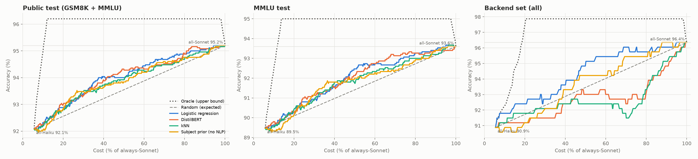
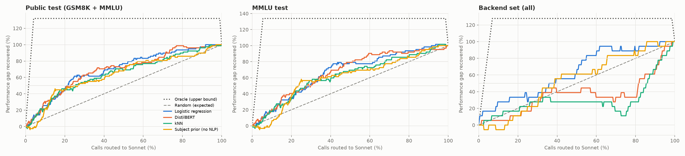
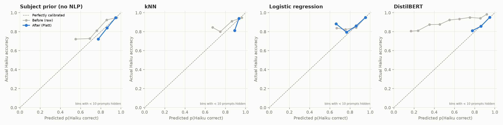

# dispatch-router

**Decide, before calling an LLM, whether a prompt can go to the cheap model (Claude Haiku 5.5) or needs the
expensive one (Claude Sonnet 5.5) — then measure honestly how much that saves and what it costs in quality.**

On 2,500 held-out GSM8K + MMLU questions, a logistic-regression router over prompt embeddings reaches
**99% of Sonnet's accuracy at 54.3% of always-Sonnet cost**
(95% CI [33.3, 66.3]%; random routing needs
71.2%). It recovers half of the Haiku→Sonnet quality gap while
sending **21.0%** of calls to Sonnet (CI [15.8, 27.7]%) and 80% while sending
**54.3%** (CI [39.6, 67.4]%); its APGR is **0.692**
(CI [0.615, 0.756]) against 0.5 for random. A fine-tuned DistilBERT does no better
and generalizes worse. Total API spend: **$3.05**.



*Each line sweeps the routing threshold from "everything to Haiku" (left) to "everything to Sonnet" (right).
Above the dashed diagonal = better than random routing; the dotted line is the oracle (perfect foresight).*

## Setup

| | |
|---|---|
| Models | `claude-haiku-5-5` (cheap) vs `claude-sonnet-5-5` (≈20× the price); thinking off, identical prompts, Message Batches API |
| Training labels | 4,816 public questions (3,000 GSM8K train + all 1,816 MMLU val/dev), each labeled "did Haiku get it right?" — 85/15 train/validation split |
| Test sets | 2,500 public (1,000 GSM8K test + 1,500 MMLU test, zero overlap with training) and a 329-question **backend-engineering set** (Python output, SQL, infra/reliability math, finance math) with gold answers computed by executing the code/SQL/formula |
| Routers | random (baseline), oracle (upper bound), subject prior (Haiku's training accuracy for the topic, no language model), kNN and logistic regression on `bge-small-en-v1.5` embeddings, fine-tuned DistilBERT (Apple MPS) |
| Calibration | Platt scaling fit on validation only |
| Uncertainty | 1,000 bootstrap resamples of the test prompts; 95% percentile CIs |

Every router outputs p(Haiku answers correctly); a prompt goes to Haiku if the score clears a threshold τ.

**Metrics.** *PGR* (performance gap recovered) = (router accuracy − Haiku accuracy) / (Sonnet accuracy − Haiku
accuracy). *APGR* = area under PGR vs. share of calls sent to Sonnet (random = 0.5). *CPT(x%)* = smallest share of
Sonnet calls that recovers x% of the gap. *Cost @ y% of Sonnet* = cheapest point whose accuracy is ≥ y% of
Sonnet's, as a % of always-Sonnet cost. *AUROC* = how well the score ranks Haiku's failures below its successes
(0.5 = chance). *ECE* = average gap between predicted and actual Haiku accuracy across 10 score bins.

## Model accuracy on the test sets

| Test set | n | Haiku | Sonnet | Only Sonnet right | Only Haiku right | Haiku cost (% of Sonnet) |
|---|---|---|---|---|---|---|
| GSM8K | 1000 | 96.0% | 97.6% | 20 | 4 | 5.4% |
| MMLU | 1500 | 89.5% | 93.6% | 83 | 21 | 5.7% |
| Backend (all) | 329 | 90.9% | 96.4% | 23 | 5 | 5.5% |
| Backend (stress tier) | 152 | 83.6% | 93.4% | 20 | 5 | 5.8% |

## Results

| Test set | Router | APGR [95% CI] | CPT(50%) | CPT(80%) | Cost @ 95% of Sonnet | Cost @ 99% of Sonnet | AUROC | ECE (calibrated) |
|---|---|---|---|---|---|---|---|---|
| Public | Random | 0.500 | 50.0% | 80.0% | 5.6% | 71.2% | — | — |
| Public | Oracle | 1.292 | 1.6% | 2.5% | 5.6% | 8.7% | — | — |
| Public | **Logistic regression** | 0.692 [0.61, 0.76] | 21.0% | 54.3% | 5.6% | 54.3% | 0.696 | 0.006 |
| Public | DistilBERT | 0.689 [0.61, 0.75] | 21.4% | 65.6% | 5.6% | 48.8% | 0.693 | 0.005 |
| Public | kNN | 0.649 [0.56, 0.72] | 25.6% | 69.7% | 5.6% | 57.1% | 0.666 | 0.017 |
| Public | Subject prior (no NLP) | 0.635 [0.55, 0.71] | 24.3% | 61.3% | 5.6% | 61.9% | 0.669 | 0.007 |
| MMLU | Random | 0.500 | 50.0% | 80.0% | 5.7% | 78.7% | — | — |
| MMLU | Oracle | 1.299 | 2.1% | 3.3% | 5.7% | 10.3% | — | — |
| MMLU | **Logistic regression** | 0.668 [0.58, 0.75] | 28.7% | 62.5% | 5.7% | 51.9% | 0.652 | — |
| MMLU | DistilBERT | 0.673 [0.59, 0.75] | 27.5% | 51.1% | 5.7% | 57.1% | 0.663 | — |
| MMLU | kNN | 0.624 [0.53, 0.71] | 27.0% | 67.8% | 5.7% | 71.9% | 0.642 | — |
| MMLU | Subject prior (no NLP) | 0.603 [0.51, 0.69] | 23.4% | 73.2% | 5.7% | 74.0% | 0.654 | — |
| GSM8K | Random | 0.500 | 50.0% | 80.0% | 5.4% | 42.3% | — | — |
| GSM8K | Oracle | 1.237 | 0.8% | 1.3% | 5.4% | 6.3% | — | — |
| GSM8K | **Logistic regression** | 0.579 [0.37, 0.73] | 32.1% | 75.3% | 5.4% | 21.8% | 0.639 | — |
| GSM8K | DistilBERT | 0.644 [0.48, 0.80] | 29.7% | 38.0% | 5.4% | 34.3% | 0.621 | — |
| GSM8K | kNN | 0.471 [0.21, 0.68] | 57.8% | 73.7% | 5.4% | 52.5% | 0.489 | — |
| GSM8K | Subject prior (no NLP) | 0.431 [0.14, 0.62] | 53.4% | 97.3% | 5.4% | 54.4% | 0.457 | — |
| Backend | Random | 0.500 | 50.2% | 80.2% | 17.0% | 83.6% | — | — |
| Backend | Oracle | 1.231 | 2.7% | 4.6% | 7.6% | 17.1% | — | — |
| Backend | **Logistic regression** | 0.634 [0.47, 0.90] | 35.9% | 55.0% | 7.5% | 55.2% | 0.641 | 0.018 |
| Backend | DistilBERT | 0.361 [0.18, 0.56] | 81.5% | 93.0% | 35.5% | 93.1% | 0.307 | 0.050 |
| Backend | kNN | 0.307 [0.11, 0.51] | 85.4% | 93.6% | 14.4% | 91.5% | 0.254 | 0.032 |
| Backend | Subject prior (no NLP) | 0.534 [0.36, 0.74] | 38.6% | 65.7% | 26.3% | 69.3% | 0.472 | 0.020 |



## What worked / what didn't

- **Routing beats random, modestly.** Logistic regression's APGR is 0.692 vs 0.5 on the public test.
  Predicting which prompts a strong cheap model will miss is hard: the oracle sits far above every router
  (APGR 1.29).
- **Most of the signal is topic difficulty.** A lookup of Haiku's training accuracy per MMLU subject — no language
  model — gets APGR 0.635. Embeddings add a real but small edge over it.
- **Simple beat complex.** DistilBERT minus logistic regression: APGR
  -0.003 on the public test
  (CI [-0.040, +0.035], no
  difference) and -0.273 on the backend set
  (CI [-0.618, -0.013]).
  DistilBERT overfits 4,093 training examples containing only 272 "Haiku wrong" cases: train AUROC
  0.91 vs validation 0.69
  (logistic regression: 0.80 vs 0.73).
- **Generalization to backend prompts.** Logistic regression keeps most of its value (APGR
  0.692 → 0.634). kNN
  (0.307, AUROC 0.25) and DistilBERT
  (0.361, AUROC 0.31) fall *below
  random*: they are most confident on multi-step finance questions that resemble GSM8K word problems — where Haiku
  is 62.5% accurate vs Sonnet 87.5%.
- **"Looks easy but isn't."** At a 30% Sonnet budget the router sends 0% of
  stress-tier Python snippets to Sonnet, though Haiku misses 4 that Sonnet gets right.
- **Classic gotchas no longer separate the models.** Mutable defaults, late-binding closures, `NOT IN` with NULLs
  and similar traps were answered correctly by both models; only the harder stress tier opened a gap.
- **Calibration.** Scores from logistic regression were already close to calibrated (public-test ECE
  0.014 raw →
  0.006 after Platt). DistilBERT's class-weighted
  training made it badly miscalibrated (ECE 0.271), which Platt scaling fixed
  (0.005). 
- **The threshold knob drifts under shift.** A τ that sends 20% of validation prompts to Sonnet sends
  32% of public-test and 43% of backend prompts there,
  because those sets are harder than validation. Re-tune τ on live traffic.
- **Sanity checks pass.** The measured random router averages APGR
  0.495–0.514 (expected 0.5) and no router
  beats the oracle on any test set.
- **The PRD's headline target was too easy.** "95% of Sonnet's accuracy" is met by always using Haiku
  (5.6% of the cost), so this README leads with 99%.

More: [backend categories](results/figures/backend_categories.png), [DistilBERT train vs validation](results/figures/distilbert_curves.png),
[more curves](results/figures/cost_quality_more.png), all tables in [`results/tables/`](results/tables/).

## Limitations

- One model pair and one snapshot of each; results may not transfer to other pairs.
- Thinking was turned off and temperature can't be set on these models, so answers aren't bit-for-bit
  repeatable; each answer was recorded once and every number replays those recordings.
- Only 103 public and 23 backend prompts are "only Sonnet right", so CIs (especially on the backend set) are wide.
- GSM8K and MMLU may appear in the models' training data; ~1–2% of GSM8K gold answers are known to be wrong.
- The backend set is synthetic and template-based; several items share a template with different numbers.
- Latency is not reported: batch calls don't expose per-request latency.

## Reproduce

```bash
uv sync
cp .env.example .env   # add ANTHROPIC_API_KEY (only needed to re-record answers)
uv run python scripts/phase0_smoke.py --run          # ~$0.0003
uv run python scripts/phase1_train_data.py --run     # Haiku labels (cached in data/responses)
uv run python scripts/phase2_build_backend_set.py    # free; verifies answers by execution
uv run python scripts/phase2_test_data.py --run      # both models on test sets (cached)
uv run python scripts/phase3_embed.py                # free, local
uv run python scripts/phase4_train_routers.py        # includes DistilBERT on MPS (~20 min)
uv run python scripts/phase5_calibrate.py
uv run python scripts/phase6_evaluate.py
uv run python scripts/phase7_honesty.py
uv run python scripts/phase9_report.py               # summary.json, this README
uv run pytest
```

Recorded responses are committed, so every step after Phase 2 runs offline and costs $0. Re-running a paid
script with the cache in place also costs $0.

## API spend

$3.05 across 7 runs (10,828 calls), itemized in
[`results/spend_ledger.csv`](results/spend_ledger.csv). Approach follows RouteLLM (Ong et al., ICLR 2025).
